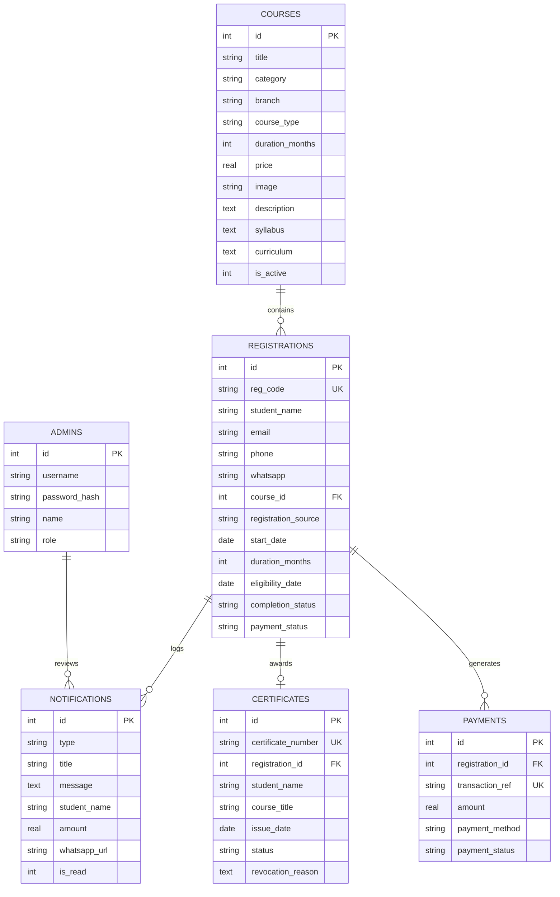

# EduCadTech — Engineering CAD Training & Certification Platform

[](https://nodejs.org/)
[](https://expressjs.com/)
[-blue.svg)](https://github.com/WiseLibs/better-sqlite3)
[](#license)

**EduCadTech** is an enterprise-grade, full-stack web application designed for a premier Engineering CAD, CAM, CAE, and IT Technical Training Institute. The platform integrates a public student-facing course catalog, interactive demo enrollment with mock payments, dynamic verifiable PDF certificate generation with cryptographic QR codes, an official public verification portal, and a protected administrative dashboard with course management and image upload capabilities.

---

## Table of Contents

- [1. Technology Stack](#1-technology-stack)
  - [Backend & Runtime](#backend--runtime)
  - [Database & Storage](#database--storage)
  - [Frontend Architecture](#frontend-architecture)
  - [Testing & Quality Assurance](#testing--quality-assurance)
- [2. Key Features](#2-key-features)
  - [Public Portal & Course Catalog](#public-portal--course-catalog)
  - [Student Enrollment & Mock Payment Engine](#student-enrollment--mock-payment-engine)
  - [PDF Certificate Generation & QR Verification](#pdf-certificate-generation--qr-verification)
  - [Administrator Dashboard & Course Management](#administrator-dashboard--course-management)
- [3. System Architecture & Directory Structure](#3-system-architecture--directory-structure)
- [4. Getting Started & Installation](#4-getting-started--installation)
  - [Prerequisites](#prerequisites)
  - [Installation Steps](#installation-steps)
  - [Environment Variables](#environment-variables)
- [5. Application Endpoints & Credentials](#5-application-endpoints--credentials)
- [6. REST API Reference](#6-rest-api-reference)
  - [Authentication & Admin API](#authentication--admin-api)
  - [Course Management API](#course-management-api)
  - [Enrollment & Payment API](#enrollment--payment-api)
  - [Certificate & Verification API](#certificate--verification-api)
- [7. Database Schema](#7-database-schema)
- [8. Operational Runbooks & Workflows](#8-operational-runbooks--workflows)
- [9. License](#9-license)

---

## 1. Technology Stack

### Backend & Runtime
- **Node.js (v18.0.0+ / v20 / v22 LTS)**: Cross-platform JavaScript runtime environment.
- **Express.js (`^5.3.0`)**: High-performance HTTP server providing routing, body parsing (`15MB` payload limit for image buffers), and static asset delivery.
- **jsonwebtoken (`^9.0.3`)**: RFC 7519 standard HMAC-SHA256 token generation and validation for admin authentication sessions.
- **bcryptjs (`^3.0.3`)**: Optimized Pure JavaScript password hashing algorithm without external C++ compilation dependencies.
- **pdfkit (`^0.20.2`)**: Vector-based PDF generation engine for rendering print-quality certificates on standard Node readable streams.
- **qrcode (`^1.5.4`)**: High-density 2D QR code generator creating scannable verification data buffers.
- **cors (`^2.8.6`)**: Middleware enabling secure Cross-Origin Resource Sharing.

### Database & Storage
- **better-sqlite3 (`^13.0.3`)**: Synchronous, zero-latency SQLite3 driver executing in Write-Ahead Logging (`WAL`) mode with automatic indexing and foreign keys enabled.
- **Local Filesystem Media Storage**: Course image uploads stored systematically under `assets/images/courses/uploads/` with sanitized timestamped filenames.

### Frontend Architecture
- **HTML5**: Semantic document structure with accessibility attributes and SEO optimization.
- **CSS3 / Vanilla CSS**: Custom design system utilizing CSS custom properties (variables), Glassmorphism, CSS Flexbox, and CSS Grid layouts.
- **Client-Side ES6+ JavaScript**: Native browser JavaScript (Fetch API, Promises, `async`/`await`, `localStorage`, EventListeners) requiring zero compilation or bundlers.
- **Libraries & Assets**:
  - **Font Awesome 4.7**: Scalable vector icons.
  - **Google Fonts**: `Rubik` and `Nunito` font families.
  - **Isotope.js & ImagesLoaded**: Dynamic multi-criteria branch and category filtering.

### Testing & Quality Assurance
- **Playwright (`^1.64.1`)**: End-to-end browser automation framework for validating authentication flows, course sync, and modal interactions.

---

## 2. Key Features

### Public Portal & Course Catalog
- **Interactive Multi-Branch Catalog (`courses.html`)**: Real-time synchronization with the database via `js/courses-sync.js`.
- **Engineering Branch Filtering**: Filter by Mechanical (`MECH`), Civil (`CIVIL`), Electronics (`ECE`), Electrical (`EEE`), Computer Science (`CSE`), and Information Technology (`IT`).
- **Course Type Categorization**: Switch between Technical and Soft Skill courses.
- **Fixed Aspect-Ratio Cards**: Every card image adheres to a strict `16:10` aspect ratio (`height: 220px`) with `object-fit: cover`, ensuring uniform card heights regardless of whether uploaded images are square, portrait, or landscape.
- **Course Content Details (`course-content.html`)**: Comprehensive syllabus breakdown, curriculum highlights, course duration, pricing, and live enrollment buttons.

### Student Enrollment & Mock Payment Engine
- **Modal-Based Registration**: Collects student full name, email, phone number, and optional WhatsApp number.
- **Live Mock Payment Gateway**: Simulates Credit/Debit Card, UPI QR Scan, and Net Banking payment transactions without requiring real banking credentials.
- **Automatic Reference Generation**: Assigns every registration a unique tracking identifier (e.g., `REG-2026-XXXXX`).

### PDF Certificate Generation & QR Verification
- **Official Security Certificate**:
  - Features guilloche decorative borders, official gold emblem seals, institute credential headers, student details, course title, and completion date.
  - Automatically incorporates a scannable QR code encoding the public verification URL.
- **Public Verification Portal (`verify.html`)**: Instant authenticity lookup by certificate number.
- **Revocation Safety**: Certificates can be revoked or reactivated by administrators with an audit reason displayed on the verification screen.
- **Automated Eligibility Calculation**: Automatic eligibility timeline computation based on course duration (1, 2, 3, 6, or 12 months).

### Administrator Dashboard & Course Management
- **Secure Access Control**: Authenticated admin session enforcement. Unauthenticated visits to `/admin` are immediately redirected to `login.html`.
- **Live Metrics Dashboard**: Real-time statistics tracking total courses, active registrations, completed courses, revenue collected, and certificates issued.
- **Course CRUD Management**: Add, edit, archive, or delete course offerings with immediate synchronization to the public website.
- **Drag-and-Drop Image Uploader**:
  - File picker & drag-and-drop dropzone.
  - Client-side format verification (`JPG`, `PNG`, `WEBP`, `GIF`) and 5MB size limit validation.
  - Live thumbnail preview with **Replace** button.
  - Base64 transmission to server with secure disk storage.
- **Offline Registration Modal**: Quick modal dialog with visible Close (`×`) button, Cancel button, Escape key dismiss, and backdrop dismissal to register classroom walk-in students without navigating away.
- **Company Notifications Log**: Centralized register of student enrollments with one-click WhatsApp Web / App contact handoff.

---

## 3. System Architecture & Directory Structure

```text
Project 2/
├── admin/                         # Administrative Dashboard SPA
│   ├── admin.css                  # Admin theme, metrics cards, uploader styles
│   ├── admin.js                   # Admin client logic, API calls, modals
│   ├── index.html                 # Protected dashboard single-page application
│   └── login.html                 # Administrator authentication portal
├── assets/                        # Static assets
│   ├── css/                       # Vendor stylesheets
│   ├── fonts/                     # Typography & icon fonts
│   └── images/                    # Course banners, default imagery, uploads
│       └── courses/uploads/       # Server-stored course upload directory
├── context/                       # Architectural specifications & documentation
│   ├── PROJECT_CONTEXT.md         # Canonical project overview & rules
│   ├── architecture.md            # Structural system & transaction designs
│   ├── coding_guidelines.md       # Development conventions & SQL safety
│   ├── tech_stack.md              # Library versions & environment specs
│   └── workflows.md               # Operational workflows & runbooks
├── db/                            # Database subsystem
│   ├── database.js                # SQLite schema definition, triggers, helpers
│   ├── database.sqlite            # Active SQLite database file
│   └── demoCourses.json           # Initial seed catalog (56 engineering courses)
├── images/                        # Institute branding, logo headers, and footers
├── js/                            # Client-side JavaScript modules
│   ├── courses-sync.js            # Live public courses fetch & Isotope sync
│   ├── enrollment.js              # Checkout modal, mock payment & registration
│   └── script.js                  # Global page UI, navigation, sliders
├── services/                      # Decoupled backend business services
│   └── certificateGenerator.js    # PDFKit vector certificate builder with QR
├── about.html                     # About EduCadTech public page
├── certificate.html               # Student certificate download portal
├── contact.html                   # Contact information & inquiry form
├── course-content.html            # Individual course syllabus & curriculum page
├── courses.html                   # Public course catalog with category filtering
├── index.html                     # Institute landing page
├── package.json                   # Project manifest & dependency declarations
├── server.js                      # Express application, REST endpoints, auth
└── verify.html                    # Public certificate QR authenticity portal
```

---

## 4. Getting Started & Installation

### Prerequisites
- **Node.js**: `v18.0.0` or higher installed ([Download Node.js](https://nodejs.org/))
- **npm**: `v9.0.0` or higher (bundled with Node.js)

### Installation Steps

1. **Clone or Navigate to the Repository:**
   ```bash
   cd "c:\Users\moham\OneDrive\Desktop\Project 2"
   ```

2. **Install Node.js Dependencies:**
   ```bash
   npm install
   ```

3. **Start the Development Server:**
   ```bash
   # Development mode with native Node file watcher
   npm run dev

   # Or standard production start
   npm start
   ```

4. **Access the Application:**
   Open your browser and navigate to:
   ```text
   http://localhost:3000
   ```

### Environment Variables

The server operates with standard local defaults, but accepts optional environment overrides:

| Variable | Type | Default | Description |
| :--- | :--- | :--- | :--- |
| `PORT` | Number | `3000` | Port on which the Express server listens |
| `JWT_SECRET` | String | `'educadtech_secret_key_demo_2026'` | HMAC secret key used for signing JWT tokens |
| `NODE_ENV` | String | `'development'` | Runtime environment profile |

---

## 5. Application Endpoints & Credentials

| Page / Feature | URL | Description |
| :--- | :--- | :--- |
| **Public Website** | `http://localhost:3000/` | Landing page, highlights, institute overview |
| **Courses Catalog** | `http://localhost:3000/courses.html` | Dynamic course catalog with branch filtering |
| **Course Details** | `http://localhost:3000/course-content.html` | Syllabus, curriculum, and enrollment trigger |
| **Student Certificate Portal** | `http://localhost:3000/certificate.html` | Student certificate search and download |
| **Public Verification** | `http://localhost:3000/verify.html` | Public QR code verification portal |
| **Admin Login** | `http://localhost:3000/admin/login.html` | Administrator authentication screen |
| **Admin Dashboard** | `http://localhost:3000/admin/index.html` | Course management, registrations, metrics |

### Default Admin Credentials

- **Username:** `admin`
- **Password:** `admin123`

---

## 6. REST API Reference

### Authentication & Admin API
- `POST /api/auth/login`: Authenticate administrator (`{ username, password }`). Returns JWT token.
- `GET /api/auth/me`: Verify session token. *Requires Bearer Token.*
- `GET /api/admin/dashboard`: Retrieve aggregated platform statistics and recent enrollments.
- `GET /api/admin/notifications`: Retrieve notification log.
- `PUT /api/admin/notifications/:id/read`: Mark notification as read.

### Course Management API
- `GET /api/courses`: Fetch public active courses. Optional filters: `?branch=MECH`, `?type=technical`, `?search=cad`.
- `GET /api/courses/:id`: Fetch single course by ID or slug.
- `GET /api/admin/courses`: Fetch all courses (active + archived). *Requires Bearer Token.*
- `POST /api/admin/courses`: Create a new course record. *Requires Bearer Token.*
- `PUT /api/admin/courses/:id`: Update existing course record. *Requires Bearer Token.*
- `DELETE /api/admin/courses/:id`: Delete or archive course. *Requires Bearer Token.*
- `POST /api/admin/upload-image`: Upload course image (`{ filename, fileData }`). Validates format and 5MB limit, saves to `assets/images/courses/uploads/`. *Requires Bearer Token.*

### Enrollment & Payment API
- `POST /api/register`: Create student enrollment record.
- `POST /api/payments/demo-pay`: Process mock payment and update registration status.
- `GET /api/admin/registrations`: Search and filter student registrations. *Requires Bearer Token.*
- `POST /api/admin/registrations/offline`: Register an in-person offline student directly. *Requires Bearer Token.*
- `PUT /api/admin/registrations/:id/completion`: Toggle completion status for certificate eligibility. *Requires Bearer Token.*

### Certificate & Verification API
- `GET /api/certificates/verify/:certNumber`: Public endpoint returning certificate authenticity and student details.
- `GET /api/certificates/:certNumber/download`: Generates and streams vector PDF certificate with embedded QR verification code.
- `GET /api/admin/certificates`: Fetch all issued certificates. *Requires Bearer Token.*
- `PUT /api/admin/certificates/:id/status`: Update status (`valid` or `revoked`) with reason. *Requires Bearer Token.*

---

## 7. Database Schema

The SQLite database (`db/database.sqlite`) comprises six interconnected relational tables:



---

## 8. Operational Runbooks & Workflows

### How to Add a New Course with an Image
1. Log in to the Admin Dashboard at `http://localhost:3000/admin/login.html`.
2. Navigate to **Course Management** in the sidebar.
3. Click the **"Add New Course"** button.
4. Drag and drop a course image into the dropzone (or click **"Browse Files"** to pick a file from your computer).
5. Enter Title, Branch (e.g. `MECH`, `CSE`), Duration, Price, and Syllabus.
6. Click **"Save Course"**. The course is immediately saved to the database and appears on the public website catalog (`courses.html`) with the uploaded image.

### How to Register an Offline Walk-In Student
1. In the Admin Dashboard top bar, click **"New Offline Student"**.
2. Fill in the student's name, email, phone number, enrolled course, and fee collected.
3. To dismiss the modal without creating a registration, click the **"Cancel"** button, the header **`×`** button, or press the **`Escape`** key.
4. To confirm, click **"Register Student"**. The student is recorded, payment is marked as paid, and an enrollment code is generated.

### How to Verify a Certificate
1. Open the camera app on a mobile device and scan the QR code printed on the bottom right of any certificate.
2. The browser automatically navigates to `http://localhost:3000/verify.html?cert=EDC-YYYY-XXXXX`.
3. The official registry confirms authenticity, student name, engineering course, completion date, and validity status.

---

## 9. License

This project is licensed under the ISC License. All rights reserved &copy; 2026 EduCadTech.
