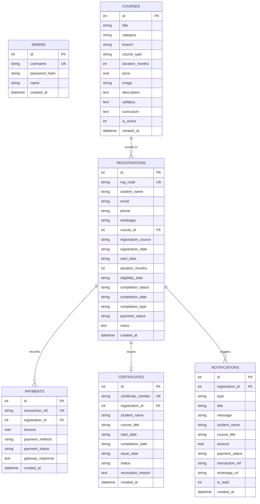

# EduCadTech — Project Context & System Documentation

> **Single Source of Truth** for the EduCadTech Full-Stack Web Application, Training Institute Portal, and Certificate Verification System.

---

## 1. Project Overview

**EduCadTech** is an end-to-end engineering training institute platform. It pairs a client-facing educational website with an administrative back-office, a student enrollment and checkout system, a certificate generation engine, and a public credential verification registry.

### Core Value Propositions
- **Course Catalog & Discovery:** Filterable multi-disciplinary course directory (Mechanical, Civil, ECE, CSE, IT) with comprehensive syllabus details.
- **Online & Offline Enrollment:** Student registration pipeline supporting both self-serve online enrollment (with simulated demo checkout) and administrative in-person offline onboarding.
- **Automated & Manual Course Completion:** Dual-mode course completion model:
  1. *Automatic Completion:* Based on course duration (e.g., 2, 3, or 6 months) and enrollment start date, evaluated continuously every 10 minutes and on student lookup.
  2. *Manual Completion:* Direct administrator override for fast-track completions.
- **Cryptographic & PDF Certificate Engine:** On-demand vector PDF certificate generation (`PDFKit`) featuring official seals, decorative borders, and dynamic verification QR codes (`QRCode`).
- **Public Credential Verification Portal:** Instant certificate validation by certificate number (`ECT-YYYY-XXXXX`), returning verified status, student credentials, issue dates, or revocation warnings.
- **Administrative Back-Office:** Secure SPA dashboard with JWT-authenticated management of courses, registrations, payments, certificates, revocations, and student communication via prefilled WhatsApp URLs.

---

## 2. Technology Stack

| Layer | Technology | Version | Purpose & Rationale |
| :--- | :--- | :--- | :--- |
| **Runtime** | Node.js | `>= 18.0.0` | Server-side JavaScript execution environment |
| **HTTP Framework** | Express.js | `^5.3.0` | Lightweight REST API routing and static file serving |
| **Database Engine** | SQLite3 (`better-sqlite3`) | `^13.0.3` | High-performance synchronous SQLite client, WAL mode, foreign keys |
| **Authentication** | JSON Web Tokens (`jsonwebtoken`) | `^9.0.3` | Stateless Bearer token admin auth with 24h expiration |
| **Security / Hashing**| `bcryptjs` | `^3.0.3` | Salted password hashing for administrative credentials |
| **PDF Generation** | `pdfkit` | `^0.20.2` | Vector-rendered A4 landscape certificate generator with custom borders |
| **QR Code Engine** | `qrcode` | `^1.5.4` | Generates verification QR code data streams embedded into PDF certificates |
| **CORS Middleware** | `cors` | `^2.8.6` | Enables cross-origin requests for API endpoints |
| **Testing Framework**| Playwright | `^1.64.1` | Automated end-to-end and headless browser validation |
| **Frontend Core** | Vanilla HTML5 / CSS3 / ES6+ JS | Native | Zero-build framework dependency; maximum performance, longevity, and ease of deployment |

---

## 3. System Architecture & Directory Layout

```
Project 2/
├── admin/                         # Administrative back-office SPA
│   ├── admin.css                  # Custom styling for dashboard, tables, badges, modals
│   ├── admin.js                   # Admin logic: auth, course CRUD, completions, revocations
│   ├── index.html                 # Main administrative dashboard interface
│   └── login.html                 # Admin authentication interface
├── assets/                        # Static vendor assets (fonts, icons, course imagery)
│   ├── fonts/
│   └── images/
├── context/                       # Comprehensive project documentation & context
│   ├── README.md                  # Context index and orientation guide
│   ├── PROJECT_CONTEXT.md         # Master system documentation (this file)
│   ├── architecture.md            # Detailed system architecture, data models, lifecycle
│   ├── tech_stack.md              # Runtime dependencies, package details, environments
│   ├── coding_guidelines.md       # Code style, security conventions, standards
│   └── workflows.md               # Developer runbook, deployment, and testing steps
├── db/                            # Database persistence layer
│   ├── database.js                # SQLite schema setup, seed data, and helper procedures
│   └── database.sqlite            # Primary SQLite database file (WAL mode)
├── images/                        # Institute branding and logos
├── js/                            # Client-side user scripts
│   ├── enrollment.js              # Student registration modal & demo payment flow
│   └── script.js                  # Frontend carousel, mobile menu, and UI behaviors
├── services/                      # Decoupled backend business services
│   └── certificateGenerator.js    # PDFKit certificate layout, vector graphics, QR code
├── about.html                     # About Us institute profile
├── certificate.html               # Student Certificate Lookup & Generation portal
├── contact.html                   # Contact details & inquiry form
├── course-content.html            # Individual course syllabus detail view
├── courses.html                   # Filterable course catalog
├── index.html                     # Institute landing page
├── package.json                   # NPM manifest and start scripts
├── server.js                      # Express HTTP server, routes, auth middleware, scheduler
├── style.css                      # Global stylesheet
└── verify.html                    # Public Certificate Authenticity Verification portal
```

---

## 4. Database Schema & Data Dictionary

The persistence layer uses SQLite (`db/database.sqlite`) managed synchronously via `better-sqlite3`. WAL mode (`journal_mode = WAL`) and foreign key constraints (`foreign_keys = ON`) are active.



### Table Definitions

1. **`admins`**: Administrative portal credentials.
   - `id`: INTEGER PRIMARY KEY AUTOINCREMENT
   - `username`: TEXT UNIQUE NOT NULL
   - `password_hash`: TEXT NOT NULL (Bcrypt)
   - `name`: TEXT NOT NULL
   - `created_at`: DATETIME DEFAULT CURRENT_TIMESTAMP

2. **`courses`**: Course catalog records.
   - `id`: INTEGER PRIMARY KEY AUTOINCREMENT
   - `title`: TEXT NOT NULL
   - `category`: TEXT NOT NULL DEFAULT `'Technical Course'`
   - `branch`: TEXT NOT NULL (`'MECH'`, `'CIVIL'`, `'ECE'`, `'CSE'`, `'IT'`, `'General'`)
   - `course_type`: TEXT NOT NULL (`'online'`, `'offline'`)
   - `duration_months`: INTEGER NOT NULL (e.g., 2, 3, 6)
   - `price`: REAL NOT NULL
   - `image`: TEXT
   - `description`: TEXT
   - `syllabus`: TEXT
   - `curriculum`: TEXT
   - `is_active`: INTEGER NOT NULL DEFAULT 1

3. **`registrations`**: Student enrollments.
   - `reg_code`: TEXT UNIQUE (`REG-YYYY-XXXXX`)
   - `student_name`, `email`, `phone`, `whatsapp`: Contact attributes
   - `course_id`: INTEGER REFERENCES `courses(id)`
   - `registration_source`: `'online'` or `'offline'`
   - `start_date`, `duration_months`, `eligibility_date`: Date computations (`YYYY-MM-DD`)
   - `completion_status`: `'not_completed'` or `'completed'`
   - `completion_type`: `'automatic'` or `'manual'`
   - `payment_status`: `'pending'`, `'paid'`, `'failed'`, `'cancelled'`

4. **`payments`**: Payment transaction history.
   - `transaction_ref`: TEXT UNIQUE (`TXN-DEMO-XXXXXX` or cash/UPI ref)
   - `registration_id`: INTEGER REFERENCES `registrations(id)`
   - `amount`: REAL
   - `payment_method`: `'demo_card'`, `'demo_upi'`, `'demo_netbanking'`, `'cash'`, etc.
   - `payment_status`: `'successful'`, `'failed'`, `'cancelled'`, `'pending'`

5. **`certificates`**: Issued credentials.
   - `certificate_number`: TEXT UNIQUE (`ECT-YYYY-XXXXX`)
   - `registration_id`: INTEGER UNIQUE REFERENCES `registrations(id)` (Strict 1:1)
   - `student_name`, `course_title`, `start_date`, `completion_date`, `issue_date`
   - `status`: `'valid'` or `'revoked'`
   - `revocation_reason`: TEXT (nullable)

6. **`notifications`**: Internal notification stream.
   - `type`, `title`, `message`, `whatsapp_url`, `is_read`

---

## 5. Core Business Logic & State Machines

### A. Automatic Eligibility & Completion Algorithm
When a student registers, their eligibility date is deterministic:
$$\text{eligibility\_date} = \text{start\_date} + \text{duration\_months}$$
- **Scheduled Auto-Completion Check:** A background timer in `server.js` triggers `checkAndUpdateAutomaticCompletions()` every 10 minutes.
- **On-Demand Auto-Completion:** Any lookup via `/api/certificates/lookup` or `/api/certificates/generate` runs `checkAndUpdateAutomaticCompletions()` prior to querying.
- **Rule:** If `payment_status == 'paid'`, `completion_status == 'not_completed'`, and `eligibility_date <= today`, status updates to `'completed'`, `completion_date = eligibility_date`, and `completion_type = 'automatic'`.
- **Manual Override:** Admin can mark completion anytime through `/api/admin/registrations/:id/completion`.

### B. Certificate Generation & Verification Flow
1. **Lookup (`POST /api/certificates/lookup`):** Matches uppercase `reg_code` and lowercase `email`. If ineligible, computes remaining days.
2. **Issue (`POST /api/certificates/generate`):** Idempotent operation. Generates unique `ECT-YYYY-XXXXX` certificate record if not already created.
3. **Download (`GET /api/certificates/:certNum/pdf`):** Renders vector PDF certificate in-memory:
   - Institute branding & gold/navy decorative double borders.
   - Dynamic QR code pointing to `${hostUrl}/verify.html?cert=${certNum}`.
   - Proper headers: `Content-Type: application/pdf`, `Content-Disposition: attachment; filename="EduCadTech_Certificate_<NUMBER>.pdf"`.
4. **Public Verification (`GET /api/certificates/verify/:certNum`):** Open endpoint. Returns valid/revoked state, student name, course, completion date, or 404.

---

## 6. API Route Specification

### Public Routes
- `GET /api/courses` — Filter courses by `branch`, `type`, `search`.
- `GET /api/courses/:id` — Get course by ID or slug.
- `POST /api/register` — Create new student registration (returns `reg_code`).
- `POST /api/payments/process-demo` — Simulate payment (`demo_outcome: 'success' | 'failed' | 'cancelled'`).
- `POST /api/certificates/lookup` — Check eligibility by `reg_code` and `email`.
- `POST /api/certificates/generate` — Generate/retrieve certificate.
- `GET /api/certificates/:certNum/pdf` — Stream certificate PDF binary.
- `GET /api/certificates/verify/:certNum` — Verify certificate authenticity.

### Admin Routes (Protected via `Authorization: Bearer <JWT>`)
- `POST /api/auth/login` — Authenticate admin (`username`, `password`), returns JWT token.
- `GET /api/auth/me` — Inspect current admin identity.
- `GET /api/admin/stats` — Dashboard metrics (counts, revenues, completion rates).
- `GET /api/admin/courses` — List all courses (including inactive).
- `POST /api/admin/courses` — Create new course.
- `PUT /api/admin/courses/:id` — Update course details/status.
- `DELETE /api/admin/courses/:id` — Soft-delete course (`is_active = 0`).
- `GET /api/admin/registrations` — Search and filter registrations.
- `POST /api/admin/registrations/offline` — Direct offline enrollment and instant payment recording.
- `PUT /api/admin/registrations/:id/completion` — Update student completion status.
- `GET /api/admin/certificates` — List all issued certificates with student contact info.
- `PUT /api/admin/certificates/:id/status` — Revoke or restore certificate (`valid` / `revoked`).
- `GET /api/admin/notifications` — Fetch recent activity notifications.
- `PUT /api/admin/notifications/:id/read` — Mark notification as acknowledged.

---

## 7. Coding Style Constraints & Engineering Conventions

1. **No Frontend Framework Build Step:** Keep client files in clean Vanilla HTML, CSS, and JS. Do not introduce React, Vue, or Webpack builds unless explicitly requested.
2. **Synchronous Prepared Statements:** Use `better-sqlite3` prepared statements (`db.prepare(...).get()`, `.all()`, `.run()`). Never concatenate unescaped user inputs into SQL strings.
3. **Consistent JSON API Contract:** All API responses must follow standard envelopes:
   - Success: `{ "success": true, ...data }`
   - Failure: `{ "error": "Clear explanation" }` or `{ "success": false, "message": "..." }`
4. **Stateless JWT Authentication:** Admin endpoints must validate `Authorization: Bearer <token>` or fallback query parameter `?token=`. Secret stored in `JWT_SECRET` environment variable with fallback for local dev.
5. **Defensive Error Handling:** Wrap async Express route handlers or database transactions with `try/catch` and return appropriate HTTP status codes (`400`, `401`, `403`, `404`, `500`).
6. **Responsive & Accessible Design:** Use standard CSS flexbox/grid, explicit font sizes, high-contrast badges, and descriptive ARIA/alt attributes.

---

## 8. Operational Runbook & Developer Workflow

### Quick Start
```bash
# 1. Install dependencies
npm install

# 2. Start server in development mode (auto-reload on file change)
npm run dev

# 3. Start server in standard production mode
npm start
```
The server binds to `http://localhost:3000` by default.

### Default Credentials
- **Admin Portal URL:** `http://localhost:3000/admin/login` or `http://localhost:3000/admin`
- **Default Username:** `admin`
- **Default Password:** `admin123`

### Demo Test Fixtures
- **Completed Student (Eligible for instant certificate):**
  - Registration Ref: `REG-2026-10001`
  - Registered Email: `arun.kumar@example.com`
- **In-Progress Student (Ineligible, shows countdown):**
  - Registration Ref: `REG-2026-10002`
  - Registered Email: `sneha.patel@example.com`
- **Pre-issued Certificate for Verification:**
  - Certificate ID: `ECT-2026-00101`
  - Verification URL: `http://localhost:3000/verify.html?cert=ECT-2026-00101`
