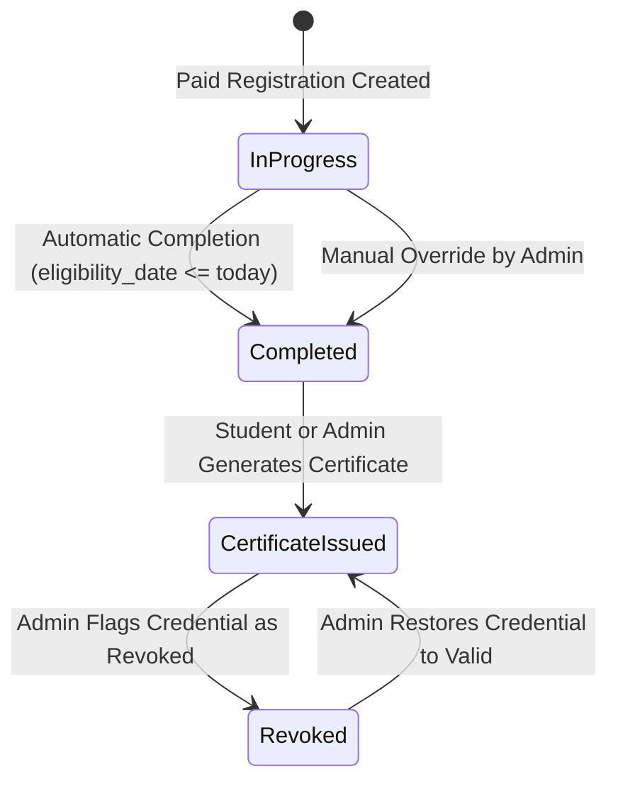

# Architectural Guidelines & System Design

This document details the software architecture, runtime behavior, data flows, and security model of the **EduCadTech** platform.

---

## 1. High-Level Architecture

EduCadTech follows a unified monolithic architecture with a Node.js/Express backend serving both dynamic REST APIs and static multi-page client assets (HTML/CSS/JS).

```
+-------------------------------------------------------------------------+
|                              CLIENT TIER                                |
|                                                                         |
|   +-----------------------+   +-------------------+   +-------------+   |
|   | Public Website (HTML) |   | Student Portals   |   | Admin SPA   |   |
|   | • index.html          |   | • certificate.html|   | • admin/    |   |
|   | • courses.html        |   | • verify.html     |   |   index.html|   |
|   | • course-content.html |   | • enrollment.js   |   |   admin.js  |   |
|   +-----------------------+   +-------------------+   +-------------+   |
+-----------------------------------|-------------------------------------+
                                    | HTTP / JSON REST
                                    v
+-------------------------------------------------------------------------+
|                             APPLICATION TIER                            |
|                                                                         |
|   +-----------------------------------------------------------------+   |
|   | Express 5 HTTP Server (server.js)                               |   |
|   | • Auth Middleware (requireAdminAuth with JWT verification)      |   |
|   | • Public API Routers (Courses, Enrollments, Payments, Certs)    |   |
|   | • Protected Admin API Routers (CRUD, Completions, Revocations)  |   |
|   | • Automatic Completion Interval Scheduler (10-minute cron)      |   |
|   +-----------------------------------------------------------------+   |
|                                   |                                     |
|               +-------------------+-------------------+                 |
|               |                                       |                 |
|               v                                       v                 |
|   +-----------------------+               +-----------------------+     |
|   | PDF Certificate Engine|               | Database Access Layer |     |
|   | (services/            |               | (db/database.js)      |     |
|   |  certificateGenerator)|               | • better-sqlite3      |     |
|   | • PDFKit Vector Engine|               | • Prepared Statements |     |
|   | • QRCode Streamer     |               | • WAL Mode Journaling |     |
|   +-----------------------+               +-----------------------+     |
+---------------------------------------------------|---------------------+
                                                    | Local File I/O
                                                    v
+-------------------------------------------------------------------------+
|                               DATA TIER                                 |
|                                                                         |
|                SQLite Database File (db/database.sqlite)                |
|             (admins, courses, registrations, payments, certs)           |
+-------------------------------------------------------------------------+
```

---

## 2. Component Breakdown

### 2.1 Backend Server (`server.js`)
- **Role:** HTTP router, session evaluator, static file server, background task scheduler.
- **Port:** Configured via `process.env.PORT` (defaults to `3000`).
- **Middleware Chain:**
  1. `cors()`: Cross-Origin Resource Sharing.
  2. `express.json()` and `express.urlencoded()`: Request payload parsing.
  3. `requireAdminAuth()`: Route-level guard inspecting `Authorization: Bearer <token>` or query parameter `token`.
  4. `express.static()`: Serves HTML, CSS, JavaScript, and static media directly from the root workspace directory with automatic `.html` extension resolution.

### 2.2 Persistence Layer (`db/database.js`)
- **Engine:** `better-sqlite3`.
- **Mode:** Write-Ahead Logging (`db.pragma('journal_mode = WAL')`) and strict foreign key validation (`db.pragma('foreign_keys = ON')`).
- **Initialization:** Automatically creates tables on boot if they do not exist, seeds default admin credentials (`admin / admin123`), populates initial course catalog entries, and injects demo registrations for testing.

### 2.3 Document Generation Service (`services/certificateGenerator.js`)
- **Engine:** `pdfkit` coupled with `qrcode`.
- **Format:** High-precision vector A4 Landscape (`841.89 x 595.28` pt).
- **Security Feature:** Embedded QR code dynamically encodes the public verification URL for instant camera scanning.
- **Graphic Assets:** Decorative double gold and navy borders, corner flourishes, academic typography, and institution accreditation watermark.

---

## 3. Data Flow & Transaction Lifecycles

### 3.1 Course Registration & Payment Flow
1. **Selection:** Student clicks "Enroll Now" on any course on `courses.html` or `index.html`.
2. **Modal Form (`js/enrollment.js`):** Student enters name, email, phone number, and optional WhatsApp contact.
3. **API Creation (`POST /api/register`):**
   - Server creates a `registrations` record with `reg_code = "REG-2026-XXXXX"`.
   - Computes `eligibility_date = today + course.duration_months`.
   - Sets `completion_status = 'not_completed'`, `payment_status = 'pending'`.
4. **Checkout Simulation (`POST /api/payments/process-demo`):**
   - User simulates credit card, net banking, or UPI checkout with outcome (`success`, `failed`, or `cancelled`).
   - If successful, updates `payment_status = 'paid'`, logs transaction in `payments` table, and queues an internal notification in `notifications` with a pre-formatted WhatsApp customer support redirect URL.

### 3.2 Completion & Certificate Lifecycle



- **Automatic Trigger:** Runs every 10 minutes in the background, as well as just-in-time when a student checks their status on `/certificate.html`.
- **Eligibility Rule:**
  $$\text{Current Date} \ge \text{Registration Start Date} + \text{Duration Months}$$
- **Idempotent Generation:** Repeated calls to `/api/certificates/generate` for the same registration will return the existing certificate number rather than generating duplicates.

---

## 4. Security Architecture

1. **Authentication:**
   - Stateless JWT tokens signed with HMAC SHA-256 (`JWT_SECRET`).
   - Expiration set to 24 hours.
   - Admin passwords hashed using `bcryptjs` with salt work factor 10.
2. **SQL Injection Defense:**
   - 100% of SQL operations execute through `better-sqlite3` prepared statements with parameterized placeholders (`?`). String concatenation in SQL is prohibited.
3. **Certificate Integrity & Verification:**
   - Each certificate is assigned a unique alphanumeric credential identifier (`ECT-2026-XXXXX`).
   - Verification endpoint `/api/certificates/verify/:certNum` is public, read-only, and displays authentic details or revocation reasons without exposing private student contact data.
